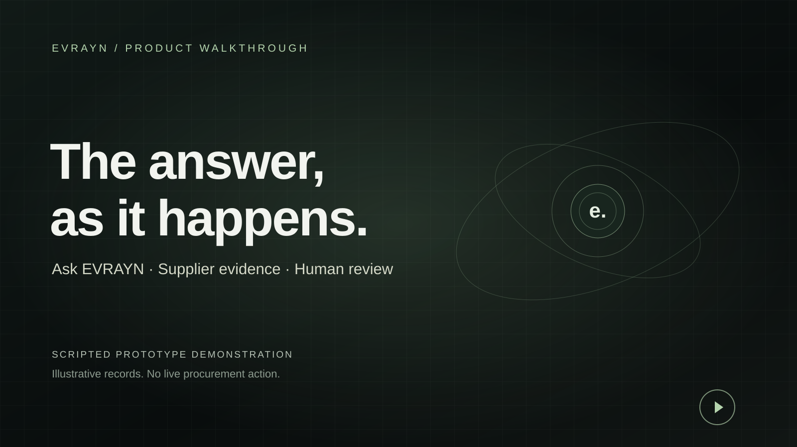

# EVRAYN
### Procurement operations intelligence

EVRAYN is an active product build focused on post-award procurement execution control. It is designed to help teams maintain a clear view of supplier commitments, milestones, expected-versus-observed status, missing evidence, delays and exceptions.

**Status:** Active build. The case study includes visual prototypes and illustrative records; it is not a claim that the full product is commercially deployed.

**Product case study:** https://jaytee-automation-engineer.vercel.app/work/evrayn

## Product focus

- Track supplier commitments and delivery milestones after a purchase order is awarded.
- Compare expected dates and states with observed updates and available evidence.
- Surface missing information, delays and conflicting signals.
- Maintain an audit trail and a clear view of what the system knows and what needs human judgment.
- Keep consequential commercial, technical, payment, quality and completion decisions under human authority.

## Ask EVRAYN: LLM-assisted interpretation

Ask EVRAYN is the conversational layer for operational questions and follow-up instructions.

1. Receive a natural-language question with authoritative project context.
2. Interpret the request and choose from controlled information-retrieval tools.
3. Ground the response in project data and available evidence.
4. Return an answer, structured information or a proposed next step.
5. Keep consequential actions behind deterministic controls and human approval.

The LLM interprets, retrieves, summarizes and proposes. Deterministic code owns authoritative state transitions, rules, authority, permissions, idempotency, routing and audit. The model does not directly write authoritative procurement state.

## Three documented validation scenarios

These are recorded project walkthroughs using synthetic test data, not a fresh benchmark or a claim that every regression is closed.

### 1. Normal Ask: expected ETA lookup

A user asks for the expected ETA of a synthetic commitment, STG-PO-1001. Ask EVRAYN returns **October 21, 2026** and distinguishes a separate acknowledgement item that has no ETA rather than inventing one.

**Result recorded:** Correct expected-ETA response and distinction between records.

### 2. Continue a pending human decision

With a human decision already pending, the user says:

> Don't approve the revised date yet. Ask the supplier whether they can recover delivery to November 8, 2026 and whether a partial shipment is possible.

Ask EVRAYN correctly treats the instruction as a continuation of the pending decision, acknowledges the context and creates a supplier follow-up action and proposal.

**Remaining regression:** The complete relationship from the follow-up action back to closure of the original decision still needs an explicit end-to-end regression in dedicated staging.

### 3. Delivery verification and completion boundary

A synthetic delivery scenario exercises the controlled path:

```text
delivered → human approval → received → human approval → verified → complete
```

An early attempt is correctly blocked when the commitment has not reached the required delivered state. After the synthetic fixture is advanced through valid states, the verification and completion flow succeeds and records the human decisions and audit events.

**Why it matters:** This is a deterministic workflow and authority-boundary test supporting the LLM feature, not an LLM benchmark.

## Visuals

**EVRAYN product overview**


**Ask EVRAYN walkthrough poster**



The Ask poster labels the demonstration as scripted, uses illustrative records and explicitly states that no live procurement action is performed.

## Architecture

See [docs/architecture.md](docs/architecture.md) for the LLM interaction and authority-boundary diagram.

## Core technology

Supabase · PostgreSQL · Supabase Edge Functions and worker workflows · Gemini-based LLM runtime path · Controlled retrieval tools · Document and evidence workflows · React / TypeScript

## Scope and limitations

This repository is a public product and architecture case study. It does not publish the private EVRAYN application source, production credentials, supplier communications, private project data, user identifiers or database records. Some documented test scenarios use synthetic data. The pending-decision closure regression remains open as described above.

[EVRAYN case study](https://jaytee-automation-engineer.vercel.app/work/evrayn) · [Portfolio](https://jaytee-automation-engineer.vercel.app/)
