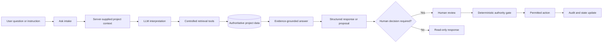

# EVRAYN architecture

EVRAYN separates AI interpretation from deterministic authority and execution.

## Ask EVRAYN path

## Authority boundary

- **AI may:** interpret language, identify intent, retrieve evidence, classify, summarize and propose.
- **Deterministic system owns:** canonical state, business rules, calculations, timers, authority, permissions, idempotency, routing, execution safety and audit.
- **Humans own:** consequential or ambiguous commercial, technical, quality, legal, payment, safety, cancellation and major-recovery decisions.

The LLM must not directly mutate authoritative procurement state.
